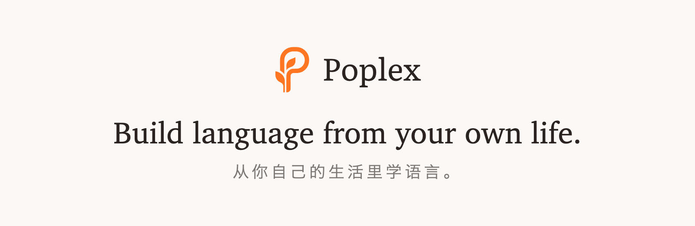
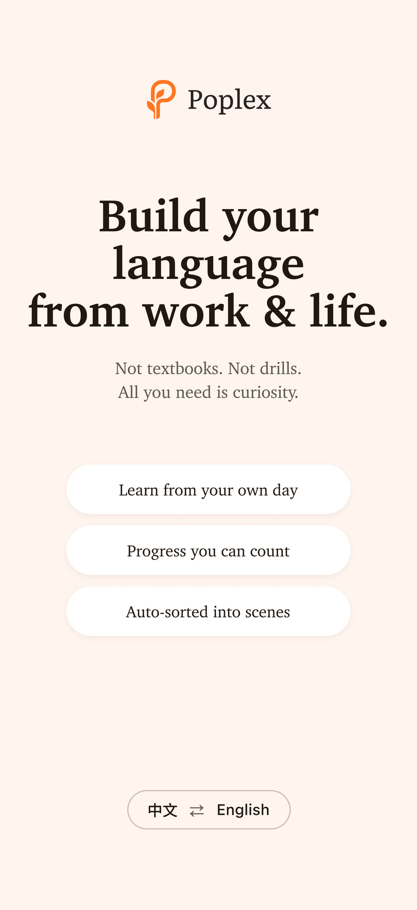
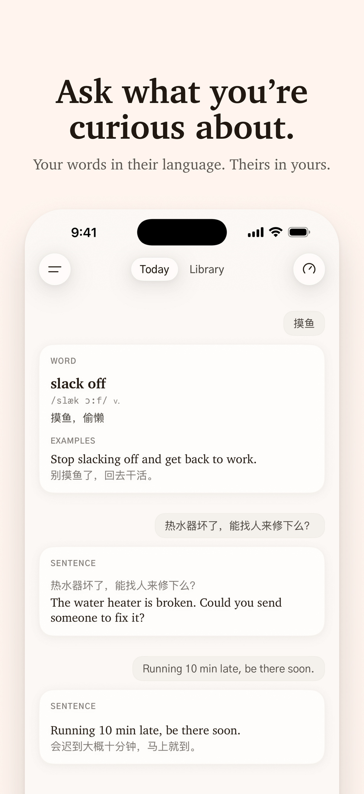
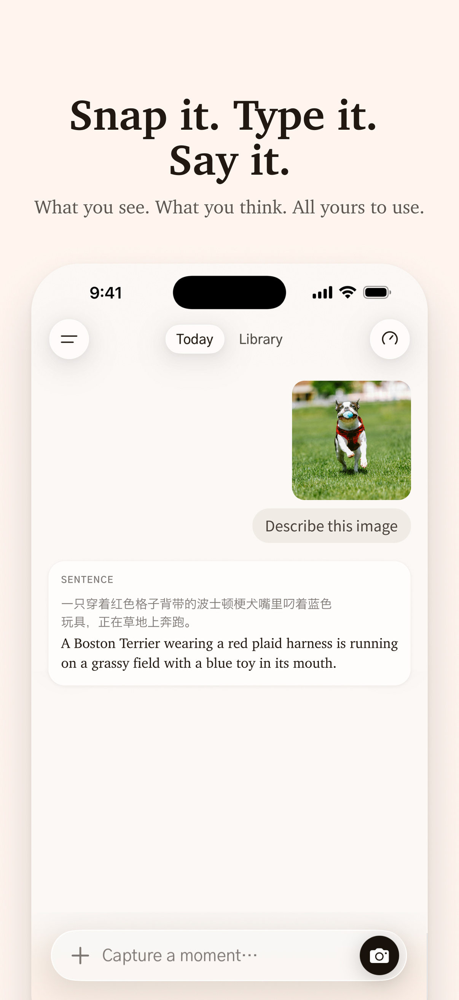
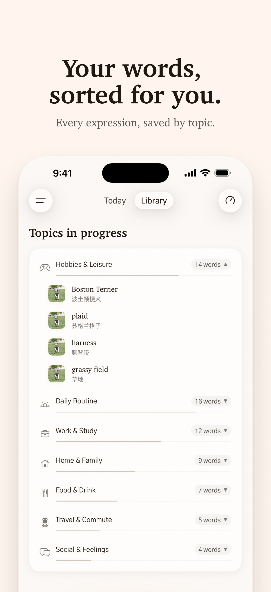
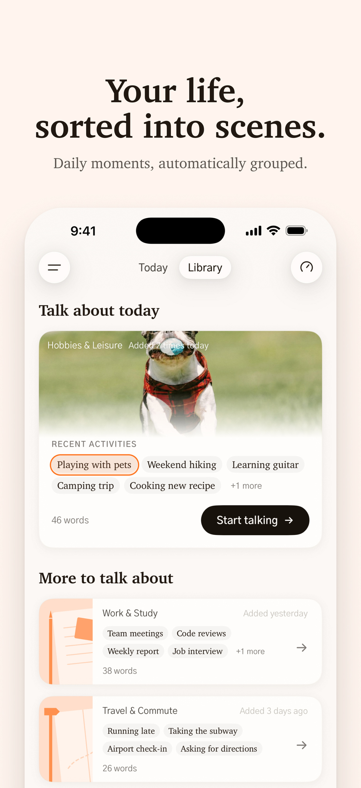

<p align="center">
  
</p>

# Poplex (AIEnglishApp)

**Build language from your own life.** Poplex is an AI-native iOS app that turns the
moments around you — a photo, a few words, a passing thought — into scene-based
language you can actually say out loud.

> **Current stage:** Poplex currently supports **Chinese → English**.

[中文说明](README.zh-CN.md)

## What it does

Poplex turns the moments of your life into language that is yours: the expressions
you actually need, organised for you automatically — so everything you capture
becomes something you can use.

### Today (Tab 1) — capture and generate

Type a sentence or add a photo (camera or gallery). The AI turns it into a learning
card with both languages side by side: write in Chinese and get the English you wanted
to say; write in English and get its meaning in Chinese; send a photo and get an English
sentence for the scene. You can keep asking about the same scene.

### Library (Tab 2) — your material, organised for you

Nothing to sort by hand. Everything you capture is organised automatically:

- **Auto-categorised** into life topics.
- **Scenes grouped automatically**, so moments from the same situation sit together.
- **Broken down into expressions** — words, phrases, collocations, idioms, sentence
  patterns — de-duplicated across everything you capture, each remembering the scenes
  it came from.

A topic unlocks once it has collected 20 expressions.

### Anonymous by design

No sign-up, no email: the app signs in anonymously on first launch and everything a
user creates stays private to that account. Account deletion removes the account and
all of its data.

The interface is English; each card pairs English with its Chinese meaning.

## Architecture

```
iOS app (SwiftUI, iOS 17+)
   │  HTTPS, user JWT
   ▼
Supabase Edge Functions (Deno / TypeScript)   ← the only place that talks to the AI provider
   │                         │
   ▼                         ▼
Postgres (RLS) + Storage     Google Gemini (gemini-3.7-flash)
```

- **The app never holds an AI key.** Every AI request goes through an Edge Function;
  the provider key exists only in the function's environment.
- **Edge Functions verify the caller's JWT** against Supabase Auth, write
  `user_id`, and filter every read by it. Tables have row-level security as defence
  in depth.
- Swapping the AI provider only touches the Edge Functions.

| Layer | Technology |
|---|---|
| App | Swift 5, SwiftUI, `@Observable`, `NavigationStack`, iOS 17+, iPhone only |
| Backend | Supabase: Postgres, Auth (anonymous), Storage, Edge Functions |
| AI | Google Gemini, called server-side only |
| Tests | Swift Testing + XCTest (UI launch / toast regression), Deno tests, pgTAP |

### Edge Functions (`supabase/functions/`)

| Function | Role |
|---|---|
| `generate` | Core pipeline: input → learning cards → materials, plus lexicon accounting |
| `get-messages`, `get-materials`, `get-vocabs`, `get-tab2-home`, `get-category-words` | Reads for Tab 1 and Tab 2 |
| `save-preset-card`, `delete-material`, `restore-material` | Writes on materials |
| `backfill-lexicon`, `reconcile-orphan-images` | Manual maintenance jobs |
| `delete-account`, `submit-feedback`, `log-event` | Account, feedback and analytics |

Schema changes live in `supabase/migrations/` (replayed from scratch by CI).

## Repository layout

```
AIEnglishApp/          iOS app — Today/ (Tab 1), Mine/ (Tab 2), Onboarding/, Settings/,
                       Services/, Models/, Theme/ (design tokens)
AIEnglishAppTests/     unit tests
AIEnglishAppUITests/   UI launch and toast regression tests
supabase/              Edge Functions, SQL migrations, database tests
scripts/ci/            verification and PR scripts used locally and by CI
docs/                  PRDs, architecture, design system, brand, engineering notes
legal/                 privacy policy, terms and support pages
CLAUDE.md, AGENTS.md   project briefs for AI coding assistants
```

Most documents under `docs/` are written in Chinese. Start here:

- [`docs/prd/整体架构_两个Tab与对话页_v1.md`](docs/prd/整体架构_两个Tab与对话页_v1.md) — product structure (Tab 1 / Tab 2)
- [`docs/prd/Agent内容组织与成长系统_PRD_v2.md`](docs/prd/Agent内容组织与成长系统_PRD_v2.md) — Tab 2, the lexicon ledger, growth layer
- [`docs/engineering/CI.md`](docs/engineering/CI.md) — pull-request verification
- [`docs/architecture/AI协作手册.md`](docs/architecture/AI协作手册.md) — how work is split between the owner and AI assistants
- [`docs/brand/README.md`](docs/brand/README.md) — brand assets and rules
- [`docs/design-system/`](docs/design-system/) — typography and component specs (colours: `AIEnglishApp/Theme/Theme.swift`)
- [`CLAUDE.md`](CLAUDE.md) — design rules, working method, decided trade-offs, current state

## Run and test

```bash
open AIEnglishApp.xcodeproj      # pick a simulator or device, then Cmd+R
bash scripts/ci/test-ios.sh      # also: test-edge-functions.sh, test-database.sh
```

The backend address and publishable key (safe to expose; protected by row-level
security) are in `AIEnglishApp/Services/SupabaseConfig.swift`. Never put the Gemini or
service-role key in the app. Pull requests must pass all three CI checks; the full
workflow, including Edge Function deployment, is in
[`docs/engineering/CI.md`](docs/engineering/CI.md) and [`CLAUDE.md`](CLAUDE.md).

## Screenshots

App Store screenshots (iPhone, English interface).

<p align="center">
  
  
  
  
  
</p>
