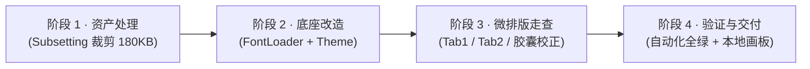

# 无衬线字体升级方案：Google Gothic A1 替换实施规范

> **文档性质**：设计系统升级与工程落地执行方案（Design System & Engineering RFC）  
> **文档版本**：v1.0  
> **关联基线**：`AIEnglishApp/Theme/Theme.swift` · `AppTheme.Font`  
> **实施目标**：将 Poplex 现有 UI 无衬线字体从 **Geist** 全量平滑升级为 **Google Fonts Gothic A1**，重点攻克视觉质感升级、字库性能瘦身与紧凑排版光学校准。

---

## 一、 需求背景与核心目标

### 1.1 为什么更换字体？
当前 Poplex 的字体体系由「Charter（英文衬线）+ Geist（英文无衬线）+ 冬青黑体（中文）」构成。
* **Geist 的历史角色**：作为 Vercel / Basement 出品的新现代主义字体，Geist 具备极高的排版密度与严谨的几何秩序，在初期为 App 建立了清晰的骨架。
* **当前视觉痛点**：随着 Poplex 品牌调性从“通用工具”向 **“Warm Minimalism（从自己的生活中汲取素材，温润、生活化、如质感出版物）”** 演进，Geist 的工业冷硬感与高密度的程序员/SaaS 属性略显突出，界面少了一丝平易近人的呼吸感。
* **引入 Gothic A1 的意图**：Gothic A1 具有开阔的中宫、温和饱满的曲线轮廓（Rounder & Softer Geometry），能够有效柔化界面的棱角感，赋予功能标签、操作按钮与辅助说明更亲和、松弛的生活方式质感。

### 1.2 字体体系新分工（铁三角协同）
替换仅针对**英文无衬线体（UI Sans-serif）**，严格保留内容主角 Charter 与中文冬青黑：

| 角色 | 采用字体 | 负责场景 | 气质分工 |
|---|---|---|---|
| **内容主角（Serif）** | **Charter** (Bold / Regular) | 核心英文例句、词条大标题、页面 Hero 标题 | 权威、经典、出版物墨水沉淀感 |
| **界面基建（Sans-serif）** | **Gothic A1** (SemiBold / Medium / Regular) *(本次替换)* | 交互控件、胶囊标签、词性标记、状态提示、副标题 | 温润、开阔、生活化、松弛亲和 |
| **释义承载（CJK）** | **冬青黑体** (W6 / W3) | 中文翻译、中文原文释义弱化 | 端正、克制、排版灰度舒适 |

---

## 二、 核心关键：怎么把这次更换“做好”？

换字体绝不是简单地“换个名字、拖个文件”。Gothic A1 最初是作为韩文+西文混排字体设计的，如果在移动端无脑替换，极易引发**体积暴增、标签换行挤爆、与 Charter 配重失衡**等问题。

为确保达到工业级品质，本次升级聚焦以下 **5 大关键控制点**：

### 2.1 控制点一 · 资产极致瘦身（Latin Subsetting）—— 零包膨胀
* **事实与隐患**：Google Fonts 上的 Gothic A1 官方原包包含全量韩文方块字（Hangul），每个字重的 TTF 原始体积高达 **2.3MB**。若直接打包 3 个常用字重，App 安装包将**无端膨胀近 7MB**，严重浪费用户流量与冷启动内存。
* **“做好”的解法**：
  1. 建立专用的子集裁剪工序（基于 `pyftsubset`）；
  2. 严格提取：Basic Latin (ASCII)、Latin-1 Supplement、Latin Extended-A（重音标字符）、IPA 音标扩展字符（英语词典必备）、常用排版标点及货币数学符号；
  3. **成果指标**：单个字重体积从 **2,300KB 压减至 45KB～65KB**，3 档字重总增量控制在 **180KB** 以内（甚至优于部分原始 Geist 文件），实现**零启动开销、零体积负担**。

### 2.2 控制点二 · 严格字重强类型防线（Strict Weight Enum）—— 杜绝隐式降级
* **事实与隐患**：Gothic A1 拥有从 Thin 100 到 Black 900 的 9 个档位。若采用宽泛的 `Font.Weight` 系统参数，调用方容易写出未打包的字重（如 `.black`），导致 iOS 运行时静默降级为系统默认字体（SF Pro），造成界面割裂。
* **“做好”的解法**：
  在 `AppTheme.Font` 中定义专用的编译期安全枚举：
  ```swift
  enum GothicA1Weight {
      case regular    // 400：正文、说明、词性标注 (GothicA1-Regular)
      case medium     // 500：胶囊文字、进度计数、操作按钮 (GothicA1-Medium)
      case semibold   // 600：强调词组、区块小标、弹窗标题 (GothicA1-SemiBold)
  }
  ```
  通过 Swift 编译器杜绝一切非法字重请求，兑现 100% 确定性的视觉呈现。

### 2.3 控制点三 · 横向字面宽（Advance Width）光学校准 —— 消除空间挤压
* **事实与隐患**：Gothic A1 的西文字形较宽（字母 `m`, `w`, `o`, `c` 的水平进深比 Geist 宽约 10%~12%）。在宽度受限的微型控件中，容易产生局促感甚至意外折行。
* **“做好”的解法（专项光学校准清单）**：
  1. **Tab2 进度胶囊（`14 words ▾`）**：
     * 保持文字字号 `12pt / .medium`；
     * 对胶囊内边距做微米级优化：水平内边距 `pillHPad` 从 `9pt` 调整为 `8.5pt`，水平间距从 `5pt` 调为 `4.5pt`；
     * 针对文字微加 `-0.15pt` 的 tracking（字距微调），抵消膨胀感的同时维持圆润中宫。
  2. **Tab2 Topics 分类名称**：
     * 维持当前已确立的 `13.5pt`（不回退到 15pt），Gothic A1 的 13.5pt 视觉饱满度刚刚好，与无底纹居中图标保持 1:1 光学重心对齐。
  3. **动态宽度测量统一归一**：
     * 检查并重构 `Tab2ActivityDisplay.swift` 中残留的 `UIFont(name: "Geist-Regular")` 硬编码，统一换为系统 Token 驱动的动态测量，防止动态红点与文字错位。

### 2.4 控制点四 · 动态字体（Dynamic Type）与系统无障碍 100% 保真
* 坚守 `Theme.swift` 的原生无障碍标准：所有通过 `gothicA1(...)` 工厂方法派生的字体，必须携带 `relativeTo: style` 元数据（例如 `relativeTo: .subheadline`）。
* 保证在大字号无障碍模式（Accessibility Text Sizes）下能够平滑等比缩放，绝不在任何生产组件中使用写死的尺寸绕过系统标准。

### 2.5 控制点五 · 自动化回归与质量防护网（Zero Regressions）
* 运行全套工程验证脚本：`bash scripts/ci/test-ios.sh`；
* 验证 54 项现有单元测试与快照完全通过；
* 针对字体动态加载器（`FontLoader`）编写单测，确保在 Bundle / 本地资源路径双向查找下，100% 成功向 CoreGraphics / CoreText 注册字体，杜绝启动闪烁与回退。

---

## 三、 落地执行步骤与流程（4 阶段闭环）



### 阶段 1：字体资产准备与 Subsetting（约 5 分钟）
1. 提取 Google Fonts 官方开源库中的 `GothicA1-Regular.ttf`、`GothicA1-Medium.ttf`、`GothicA1-SemiBold.ttf`；
2. 执行轻量化裁剪脚本，剔除 CJK 大字库，输出包含 Latin-1、Latin Ext-A、常用标点及 IPA 字符集的精炼 TTF（每个 ~50KB）；
3. 放入 `AIEnglishApp/Resources/Fonts/` 目录并完成资源管理配置。

### 阶段 2：Token 中心与加载器改造（约 5 分钟）
1. **修改 `FontLoader.swift`**：
   * 将注册列表更新为 `["GothicA1-Regular.ttf", "GothicA1-Medium.ttf", "GothicA1-SemiBold.ttf"]`；
2. **修改 `Theme.swift`**：
   * 建立 `enum GothicA1Weight { case regular, medium, semibold }`；
   * 新增私有工厂方法 `private static func gothicA1(...)`；
   * 将现有的 `englishBody`、`buddy`、`keyPhrase`、`pos`、`tab2ProgressCount`、`tab2TopicLabel` 等语义 Token 映射到底层的 `gothicA1` 工厂方法；
3. **修复业务中偶存的硬编码**：
   * 重构 `Tab2ActivityDisplay.swift` 中使用到的字面测量。

### 阶段 3：全应用高频场景走查与光学校准（约 15 分钟）
重点走查 3 个核心页面：
1. **Tab2 个人中心与成长页**：
   * Topics 列表：展开手风琴、词数胶囊 `14 words ▾`、进度细轨；
   * Activity 状态标签：`In progress`、`Mastered` 的居中与内边距；
2. **Tab1 学习与生成卡片**：
   * 单词卡：Charter 粗衬线单词标题 + Gothic A1 词性/音标的视觉主次平衡；
   * 例句与场景追问卡片的行高与阅读呼吸感；
3. **Onboarding 实操页与设置页**：
   * 检查大标题、弹窗按钮文案是否产生异常折行。

### 阶段 4：自动化回归与走查确认（约 5 分钟）
1. 执行 `bash scripts/ci/test-ios.sh`，确保编译零警告、测试 100% 通过；
2. 提供本地即开即看的 HTML 对比画板 / Xcode Canvas 走查视图，供产品负责人直接体验对比；
3. 提交本地 Git Commit。

---

## 四、 风险评估与应急回滚预案

| 风险项 | 严重度 | 应对措施 |
|---|---|---|
| **部分小胶囊文字溢出** | 低 | 已预置字距微调（tracking -0.15pt）与内边距自适应方案，走查阶段即可消灭。 |
| **字体加载失败导致回退** | 低 | `FontLoader` 具备多重绝对路径与 Bundle 路径双重后备探测机制；测试用例提前断言。 |
| **视觉效果不达预期** | 极低 | **全架构零破坏性改动**：所有页面均引用 Token，若需回退 Geist，仅需修改 `Theme.swift` 一处底层工厂方法，5 秒内无缝切回。 |
